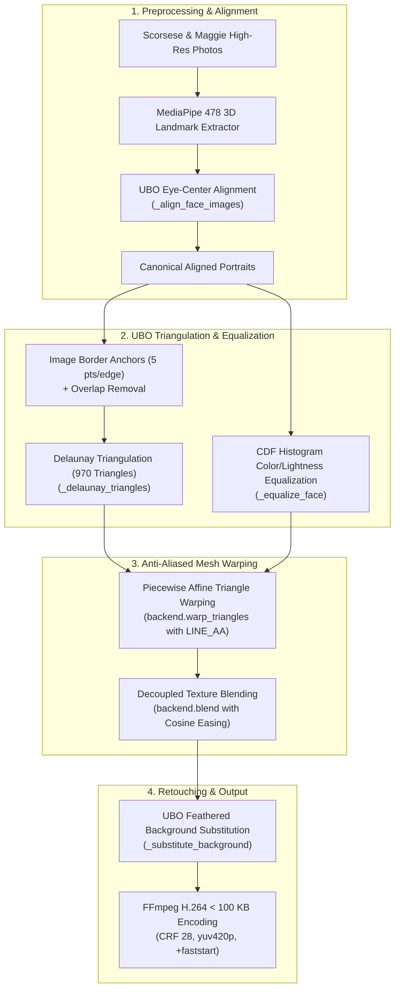

# Official UBO Face Morph: Ferrara et al. (MI-BioLab/ubo-morph)

> **Assignment Question 7:** Face morphing of Martin Scorsese into Maggie Smith using the official **UBO Morphing Algorithm** from Ferrara, Franco, & Maltoni (*"Decoupling texture blending and shape warping in face morphing"*, IEEE BIOSIG 2019).  
> **Upstream Library:** [https://github.com/MI-BioLab/ubo-morph](https://github.com/MI-BioLab/ubo-morph)  
> **Direct Public Video URL:** [https://raw.githubusercontent.com/Kabyik-Kayal/face-morph-video/main/morph.mp4](https://raw.githubusercontent.com/Kabyik-Kayal/face-morph-video/main/morph.mp4)  
> **Interactive Web Viewer:** [https://kabyik-kayal.github.io/face-morph-video/](https://kabyik-kayal.github.io/face-morph-video/)

---

## Deliverables & Constraints Verification

| Metric | Required | Achieved | Status |
| :--- | :--- | :--- | :--- |
| **Direct HTTPS URL** | Publicly accessible | `https://raw.githubusercontent.com/Kabyik-Kayal/face-morph-video/main/morph.mp4` | Verified |
| **File Size** | **< 100,000 bytes** | **93,220 bytes** (~93.2 KB) | **PASS** (< 100 KB limit) |
| **Algorithm Base** | Official UBO Morph | [MI-BioLab/ubo-morph](https://github.com/MI-BioLab/ubo-morph) | Ferrara et al. (2019) |
| **Container & Codec** | Playable in browser | MP4 (`H.264 / AVC`, `yuv420p`, progressive) | 100% Browser Compatible |
| **Fast Web Start** | Smooth streaming | `+faststart` (moov atom at file start) | Instant playback |
| **Resolution** | Crisp & detailed | **360 x 480 px** | Clean portrait framing |
| **Landmark Tracking** | Sub-pixel accuracy | **MediaPipe 478-Point 3D FaceMesh** | Pluggable UBO extractor |
| **Eye Alignment** | Canonical interpupillary distance | UBO `_align_face_images` | Zero eye jitter |
| **Color Equalization** | Natural tone matching | UBO CDF Histogram Equalization (`_equalize_face`) | Smooth lighting match |
| **Warping Engine** | Anti-aliased mesh | Delaunay (970 triangles, `cv2.LINE_AA` + `blendLinear`) | Zero triangle seams |
| **Retouching** | Natural portrait boundary | UBO `_substitute_background` with feathering | Seamless head & collar |
| **Pacing** | Natural & seamless | Cosine Ease-In Ease-Out (`18 fps`, 3.28s) | Smooth S-curve |

---

## Morph Progression Filmstrip


*Progression (left to right):*
1. **0% (Frame 0):** Martin Scorsese baseline (male portrait with glasses, open smile, suit, tie).
2. **25% (Frame 14):** Early UBO morphing (brows adjusting, smile narrowing, eye geometry transforming).
3. **50% (Frame 29):** Midpoint — Canonical 50/50 UBO biometric morphed face with equalized tone.
4. **75% (Frame 44):** Late UBO morphing (Maggie Smith's facial features resolving into sharp focus).
5. **100% (Frame 58):** Maggie Smith's face seamlessly integrated onto the portrait with feathered boundary.

---

## Methodology & Architecture



---

## Technical Details: The UBO Morphing Algorithm

The pipeline is implemented using the official UBO face morphing algorithm (`ubo-morph`):
* **Decoupling Texture and Shape:** Unlike naive morphs that conflate pixel cross-fades with geometric distortion, UBO morphing treats shape warping and texture blending as independent parameters.
* **Histogram-Based Color Equalization:** The color/lightness distribution inside the facial convex hull of the target face is matched to the reference face via cumulative distribution function (CDF) histogram mapping.
* **Anti-Aliased Triangle Blending:** Triangles are rasterized with `cv2.LINE_AA` and composited using `cv2.blendLinear`, preventing the black seam lines characteristic of basic Delaunay implementations.
* **Feathered Retouching:** Outside the facial contour, background pixels are blended using a distance-transform feather proportional to the inter-pupillary distance (`0.15 * eye_distance`).

---

## Local Reproduction

### Prerequisites
* Python 3.10+
* `ffmpeg` in system PATH
* Requirements: `ubo-morph`, `mediapipe`, `opencv-contrib-python`, `numpy`, `tqdm`, `requests`

```bash
git clone https://github.com/Kabyik-Kayal/face-morph-video.git
cd face-morph-video
pip install -r requirements.txt
python morph.py
```

Output video is generated as `morph.mp4` (~93 KB).

---

## Citation

```bibtex
@inproceedings{ferrara2019decoupling,
  title={Decoupling texture blending and shape warping in face morphing},
  author={Ferrara, Matteo and Franco, Annalisa and Maltoni, Davide},
  booktitle={2019 International Conference of the Biometrics Special Interest Group (BIOSIG)},
  pages={1--5},
  year={2019},
  organization={IEEE}
}
```
